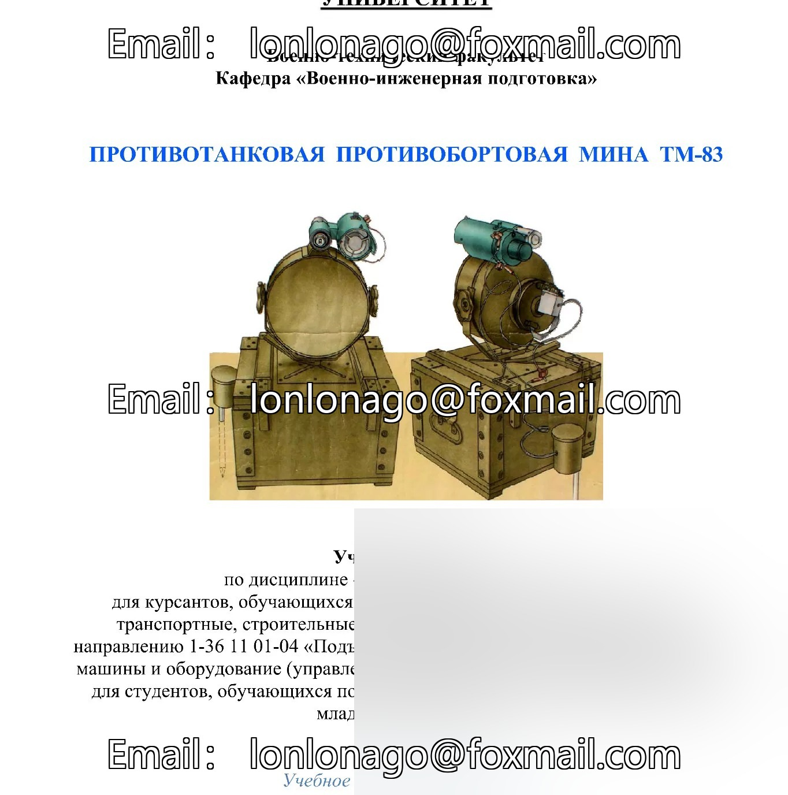
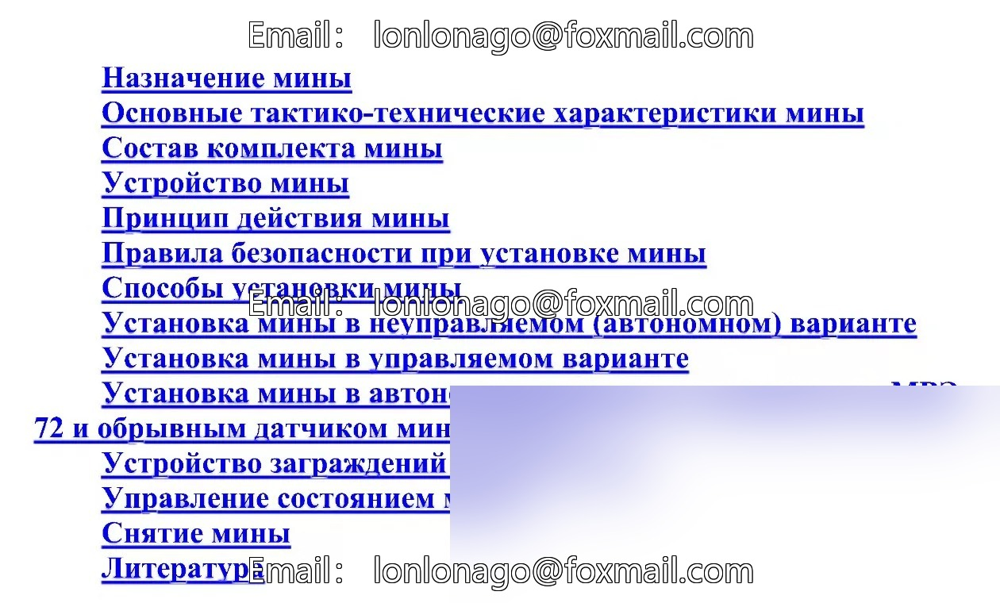
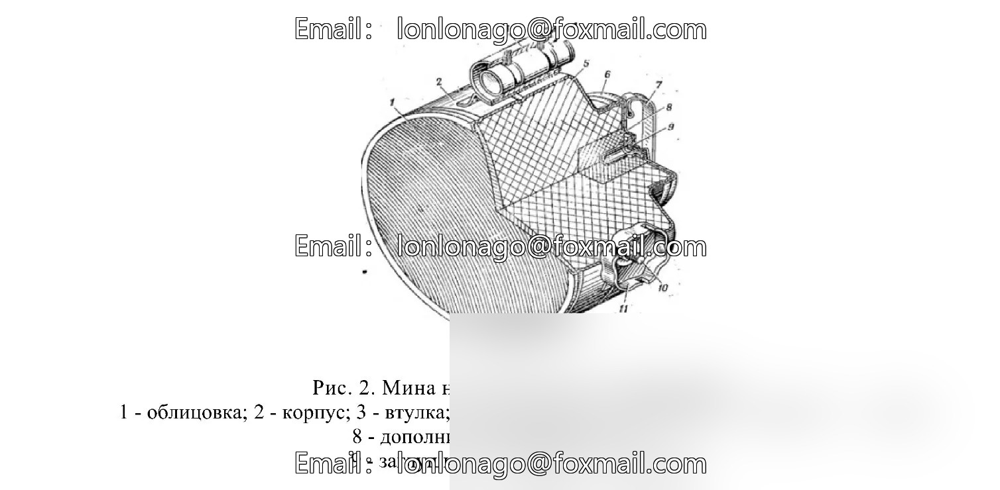
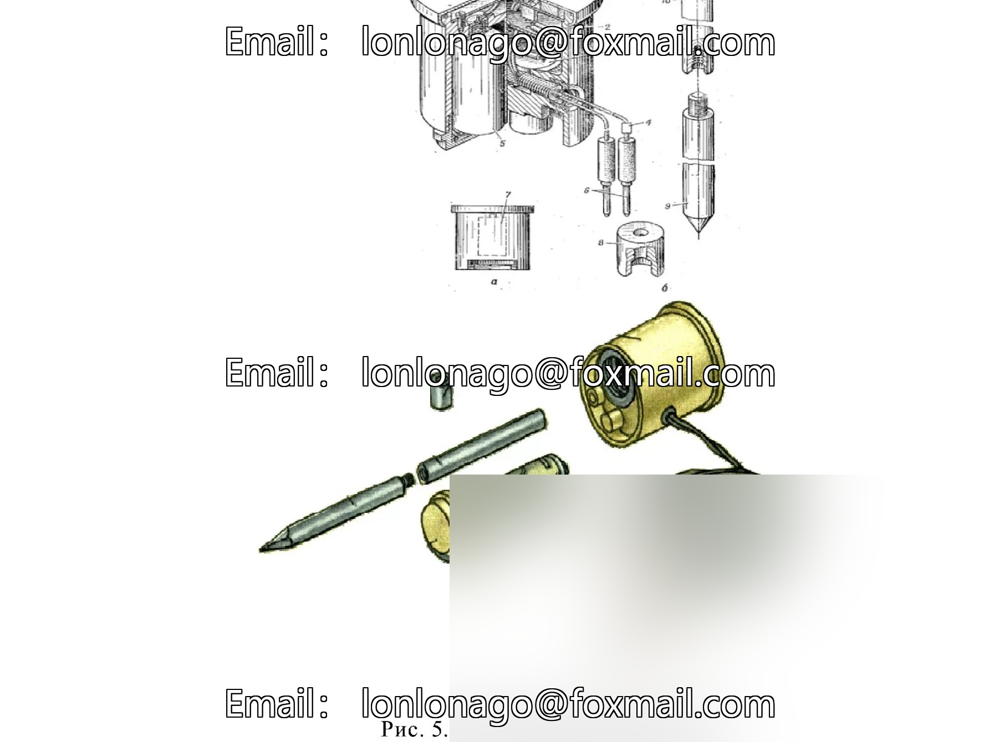

# TM-83 anti-tank anti-infantry mine teaching materials

## Body

TM-83 Anti-tank and anti-infantry mine teaching materials
1. Material system
1. TM-83 mine structure and function
2. Detailed explanation of mine working principle
3. Installation and use specifications
4. Safety operation standards
5. Mine setting methods
6. Mine maintenance and protection
7. Mine removal procedures
2. Document characteristics
1. Professional textbook content from academic institutions
2. Fully covers key points of mine technology
3. Instruction manual for practical application
4. Suitable for students of military institutions
are copyable.
Rejected upon sale.

The materials cover TM-83 anti-tank and anti-infantry mine structure and function, operation principles, installation and usage, safety protocols, deployment methods, maintenance and dismantling procedures, plus professional school materials and practical application guidance.

<!-- AI_ENRICHED -->

## Images

## Payment

Here is a pay link on Stripe ( https://buy.stripe.com/3cs8yP7sY87d0vu9AB ). Please contact me lonlonago@foxmail.com after funding $89, and I will send you a complete data files , thank you!

